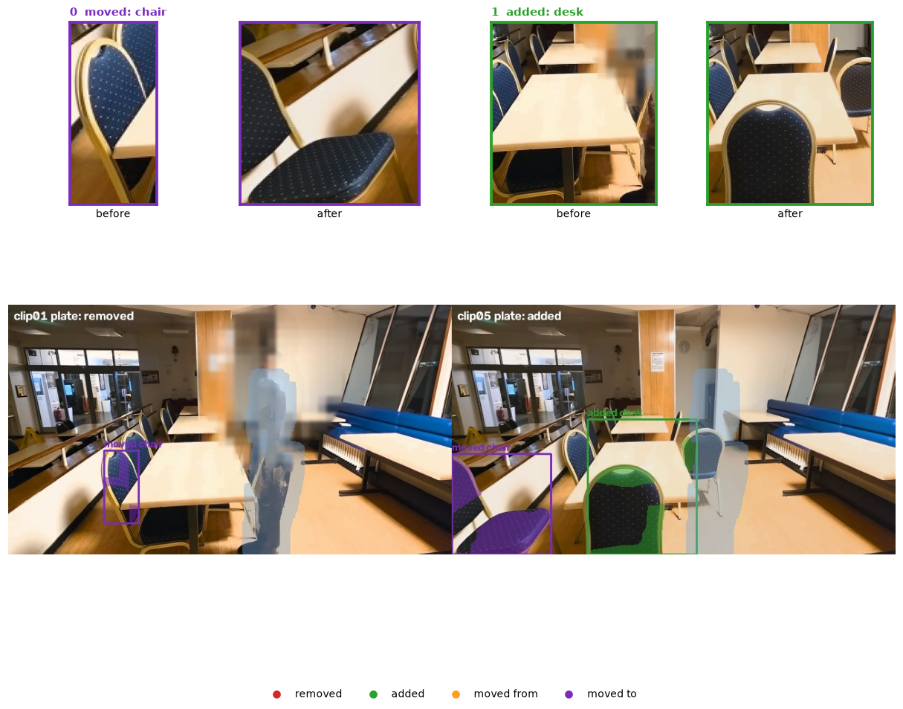
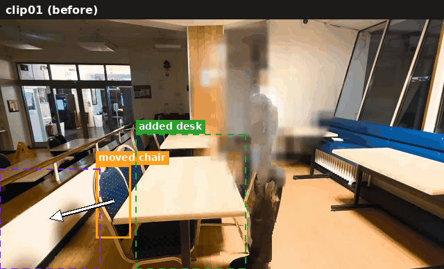
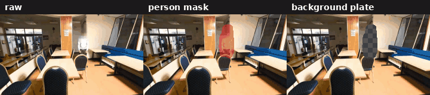
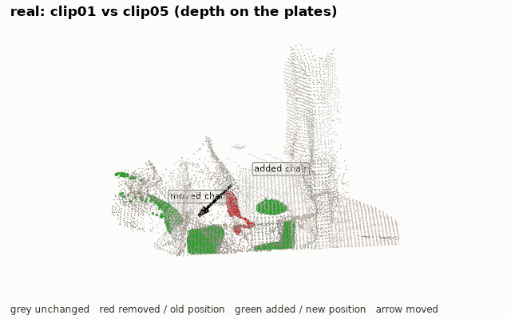
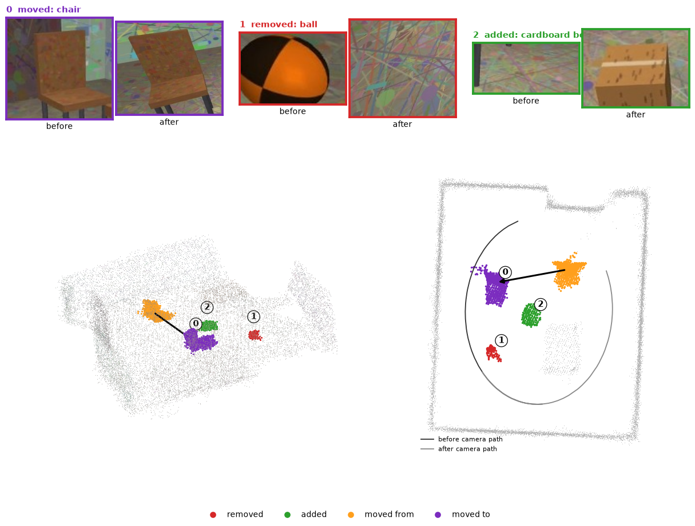
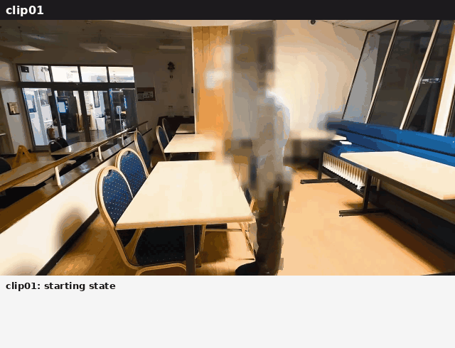

# Room Change Detection 3D

Visibility-aware 3D change detection from two phone videos.

Give it two recordings of the same room. It builds a shared 3D model, finds what was moved, added
or removed, labels each change and writes a sentence about it. A change is only reported when the
other recording looked straight through the space where the object used to be (or now is):
**free-space ray voting**. Parts of the room that one recording never saw are marked unobserved,
not changed.



*Real capture, clip01 vs clip05 (fixed camera, a person walks through every clip). Top: before/after
crops per change. Bottom: change masks on the person-free background plates; pale blue = never
visible behind the person, so not judged.*



*clip01 and clip05 plates, alternating; solid box = object present in this frame, dashed = where it is in the other.*

## Two modes

| mode | input | 3D model |
|---|---|---|
| walkaround (default) | two handheld videos, different paths | joint SfM (pycolmap) over frames of both videos + monocular depth fused into voxels |
| `--static` | 2+ clips from one tripod position | one metric depth map per clip on a person-free background plate |

The real data in `data/real/` (six clips, faces pixelated) was filmed from a **single static
viewpoint**, so it exercises the static mode. The walkaround mode is what handles different
viewpoints and partial overlap; it is tested on the synthetic benchmark below, not on real video yet.

## Install

```
git clone https://github.com/megazron/room-change-detection-3d
cd room-change-detection-3d
make setup        # python3 -m venv .venv && pip install -r requirements.txt
```

Python 3.10+. CUDA is used if available (4 GB is enough), otherwise everything runs on CPU, slower.
Model weights (Depth Anything V2 metric-indoor small, CLIP ViT-B/32, Mask R-CNN) download on first use.

## Run

```
make demo         # render the synthetic room (once), detect, score against ground truth
make bench        # both synthetic scenes
make real         # the six real clips: consecutive pairs + clip01 vs clip05, scored

python -m rayvote before.mp4 after.mp4 --out out/room                   # your own walkarounds
python -m rayvote --static c1.mp4 c2.mp4 c3.mp4 --pair 1,3 --out out/x  # fixed camera
```

Intermediate results (keyframes, SfM, depth, plates) are cached under `<out>/cache`, so re-runs take
seconds to a minute. Seeds are fixed. Runtime on an RTX A500 laptop: synthetic pair 5-7 min on the
first run (CPU SfM is most of it), the six real clips about 3.5 min.

## How to record

Walkaround mode: two slow 20-40 s walks around the same area along different paths, phone at chest
height, overlapping views of the static background. Between them move one object, add one, remove
one. Good light, no fast pans. Static mode: tripod, same framing for every clip.

## Method

1. **Keyframes**: 40 per video, sharpest (Laplacian variance) in each time bin.
2. **Shared frame**: all keyframes of both videos go into one COLMAP model. The unchanged room
   anchors both recordings in one coordinate frame; moved objects are just outlier matches.
3. **Dense geometry**: metric monocular depth per frame, aligned to the SfM points (global scale,
   per-frame scale/shift, then a per-pixel correction from nearby SfM points in image+depth space).
   Pixels that do not agree with at least 2 neighbouring frames of the same recording are dropped.
   The rest is fused into a 5 cm voxel cloud per recording.
4. **Free-space ray voting**. For a voxel at depth `z` in a camera of the *other* recording, read
   the observed depth `d` over the voxel's projected disc (radius 8 cm):

   ```
   camera ------------------------ X ------------- d
                                   z
   min d  >  z + m   ->  FREE        the ray passes through X: X is gone
   max d  <  z - m   ->  OCCLUDED    something in front: no evidence
   otherwise         ->  CONSISTENT
   m = max(0.12, 0.08 z) / max(|cos incidence|, 0.3)    (grazing rays need a wider margin)
   ```

   Removed = before-voxel with `FREE >= 3` and `FREE >= 0.7 (FREE + CONSISTENT)` over the after
   cameras; added is the same with roles swapped. `FREE + CONSISTENT < 2` = unobserved.
5. **Clusters**: DBSCAN, then drop flat patches, slivers, and clusters where the other recording
   triangulated SfM points (sparse veto: it saw a surface there).
6. **Semantics**: best unoccluded view per cluster, crop, zero-shot CLIP label (vocabulary in
   `rayvote/semantics.py`, override with `--vocab`). Removed/added pairs with similar CLIP embedding
   and size become **moved**, with a 3D displacement.
7. **Language**: template sentences from the geometry: support (floor / surface height), size,
   region of the room, displacement direction, nearest other change.

Static mode replaces 1-3 with: person masks (Mask R-CNN + large motion blobs), temporal median plate
over unmasked samples, metric depth on the plate, a SIFT homography check between clips (warps if
the camera moved more than 1.5 px). Voting is the same rule along each pixel ray, plus a colour-change
cue. Pixels hidden by the person in almost all samples are unobserved.



*clip05: raw samples, person mask, and the plate as the median of unmasked samples builds up (checker = not seen yet).*



*clip01 vs clip05 back-projected from the plate depth maps: grey unchanged, red removed or old position, green added or new position, arrow = move.*

## Outputs (`--out`)

`changes.json` (type, label, confidences, centroid, bbox, displacement, evidence), `report.md`
(sentences + before/after crops), `viewer.html` (plotly 3D: scene grey, removed red, added green,
moved orange to purple with arrow, unobserved pale blue; hover for the description), `hero.png`,
`scene.png`. Static mode adds `overlay.jpg` (person and change masks) and `timeline.md/json/jpg`.
Examples: [docs/synthetic](docs/synthetic/report.md) (with `viewer.html`), [docs/real](docs/real/report.md).

## Results

**Synthetic** (MuJoCo room with textured walls, `tools/make_synthetic.py`; each scene has one moved,
one added and one removed object; the two videos use different camera paths; scored by
`tools/eval_synthetic.py` with a 0.5 m match radius after aligning camera centres to ground truth):

| scene | precision | recall | label acc. | position error |
|---|---|---|---|---|
| a (chair moved, box added, ball removed) | 1.00 | 1.00 | 3/3 | 0.00-0.28 m |
| b (box moved, bin added, chair removed) | 0.60 | 1.00 | 2/3 | 0.03-0.40 m |

Scene b false positives: a static ball right under the start of the before path (seen only at close
range near the image border) and a fragment next to the added bin. Two synthetic scenes, not a
general accuracy claim.



**Real** (static camera; annotations in `data/real/ground_truth.json`, scored by
`tools/eval_real.py`, match radius 12 % of the image; `docs/real/timeline.jpg`):



*Each step of the timeline on the newer plate, with the generated description; steps without change are shown too.*

| pair | ground truth (from the plates) | detected | tp / fp / fn |
|---|---|---|---|
| clip01 -> 02 | chair added front right (+ chair behind the table, see below) | added chair | 1 / 0 / 0 |
| clip02 -> 03 | nothing | nothing | 0 / 0 / 0 |
| clip03 -> 04 | front-left chair moved to the left foreground | removed "table" + added chair | 1 / 0 / 0, split |
| clip04 -> 05 | front-right chair moved to front centre | moved chair, 1.3 m | 1 / 0 / 0 |
| clip05 -> 06 | nothing | nothing | 0 / 0 / 0 |
| clip01 -> 05 | front-left chair moved to left foreground, chair added front centre | moved chair, added chair | 2 / 0 / 0 |

Precision 1.0, recall 1.0 on 5 annotated changes, with one move reported as removed + added
(the removed crop includes the table and got the wrong label, so the pair was not matched). Six
pairs from one room; the annotation is mine, so treat this as a sanity check, not a benchmark.

Notes on the annotation. The front-left chair is not just hidden in clip04/05: its spot is visible
and empty, and a chair appears in the left foreground (`docs/real/left_side_plates.jpg`), so it is
annotated as moved. The chair added behind the right end of the table in clip02 stands where the
person stood for most of clip01; that spot is never seen in clip01, so it is marked unobserved and
not claimed either way (the annotation lists it as optional). The person is in every clip and is
never reported. Plate alignment between clips: 0.1-1.2 px median shift, 0.1-0.2 px residual.

Static-mode edge cases: a person standing in one place for the whole clip leaves a plate hole,
which becomes unobserved; exposure and white balance are matched between plates by a per-channel
gain/offset fit; a camera shift is detected by SIFT homography (warped if > 1.5 px, warning if the
residual is > 1 px); unreadable, empty or very short videos and clips with different aspect ratio
or orientation stop with an error; pairs with no change produce an empty list. A removed region is
not trusted next to a newly added object (the new object can hide the old one and its depth bleeds),
and is dropped if most of it lies in that band.

## Limitations and tradeoffs

- Monocular depth sets the metric scale, so distances are approximate (synthetic: 0.5 % and 6.5 %
  scale error). Thin parts (legs) and the lowest few cm of objects on the floor are not detected.
- Textureless rooms starve SfM; reflective and transparent objects break depth. Flat objects
  (< 4 cm thick) are filtered out on purpose, so a moved rug or book is missed.
- People are masked in static mode; in walkaround mode a person standing still would look like an
  added object.
- CLIP labels crops of busy scenes poorly at times; each label carries its confidence.
- Robustness over recall: conservative free-space test (the whole disc must be behind), sparse veto,
  size/shape filters. Missing a small change is preferred to inventing one.

## Privacy

`tools/anonymize.py` pixelated heads in the real clips before they were added here (pose landmarks,
moving-blob head and face detector; regions held for 15 frames; no audio or metadata). The originals
are not in the repo. Colours look slightly saturated because the phone recorded HLG HDR.

## Layout

`rayvote/`: `pipeline.py` walkaround mode, `static.py` fixed camera, `geometry.py` fusion and voting,
`describe.py` sentences. `tools/`: synthetic scenes, scoring, anonymisation. `docs/`: example outputs.
