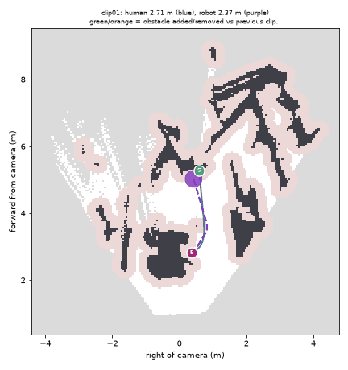
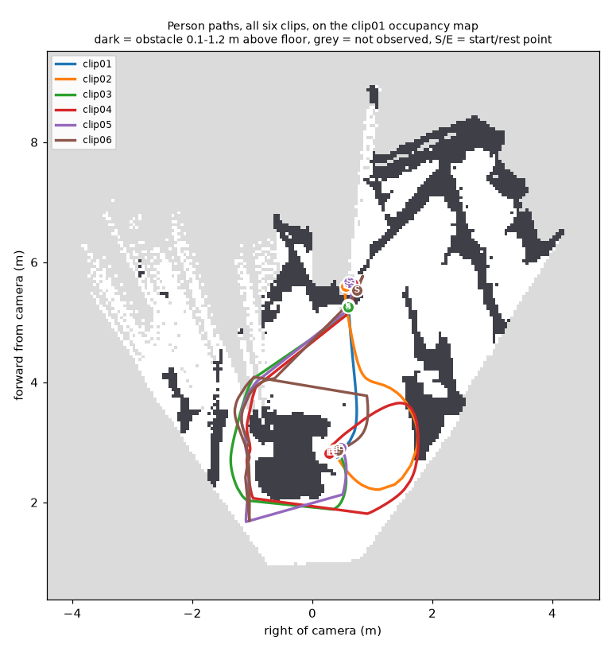
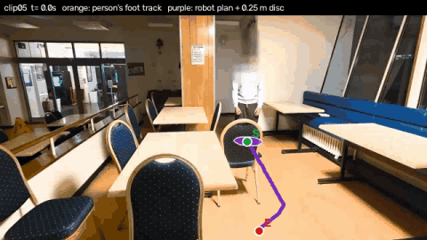

# Person paths and a robot navigation baseline (real clips)

`make paths` (after `make real`) reads the six static-camera clips in `data/real`, reuses the cached
person-free plates and metric depth maps from `out/real/cache`, and writes everything below to
`docs/real/paths/` (numbers in `paths.json`).

## Method

**Shared floor frame.** All clips come from one tripod, so they share one camera. A RANSAC plane fitted
to the clip01 plate depth (Depth Anything V2, metric indoor) is the floor; the other clips' plate depths
are put on clip01's scale with a robust scale/shift fit on pixels that are static in both. Frame: x =
forward from the camera along the floor, y = left, origin on the floor under the camera (1.89 m above
the fitted floor, 65 degree horizontal FOV assumed).

**Person track.** Every second frame (15 Hz) gets Mask R-CNN person instances; one person is followed by
mask overlap. The ground contact is the bottom of the mask; its pixel ray is intersected with the floor
plane. The feet count as visible only if the mask bottom is off the image border, the plate just below
it is floor-level, and it is not far above where the body says the feet should be. When the feet are
hidden (behind a chair or the table, or below the image), the foot pixel is extrapolated from Keypoint
R-CNN shoulders and hips: `foot row = hip row + 1.18 x (hip row - shoulder row)`, with 1.18 the median
over 352 frames where both were visible, then the same floor-plane intersection (`cue = pose`). The
mask top is not used: faces are pixelated, so the head often drops out of the mask, and the camera sits
near head height, which makes a height prior ill-conditioned. Jumps > 0.6 m from the running median are
dropped and the track is smoothed with a 0.4 s Gaussian.

**Endpoints.** Start = the first three confident fixes within 0.5 s, median of the three. End = the last
rest window in the second half of the clip (smoothed speed < 0.2 m/s for >= 1 s, gaps < 1 s allowed),
median foot point over it. Each choice was checked by eye on `real/paths/endpoints_clipNN.jpg` (first
frame and rest frame side by side, foot point marked).

**Occupancy.** Plate pixels are back-projected (pixels on depth edges skipped, where monocular depth
smears). Cells with >= 2 points 0.10-1.20 m above the floor are obstacles; floor points and the cells
a pixel ray crosses below 1.2 m before it hits a surface are free; the rest is unknown. Cells a clip
never saw (the person was standing there) borrow the majority vote of the other clips. 5 cm grid.

**Planner.** 8-connected A* on the grid inflated by a 0.25 m robot radius; unknown cells cost 3x, and
unknown cells away from anything observed are not allowed. Start and goal snap to the nearest free
cell reachable from the start, and the snap distance is reported. The plan is shortened by
line-of-sight shortcutting. "Previous plan blocked" = the previous clip's plan crosses this clip's
inflated obstacles.

## Endpoints

| clip | start (x, y) m | start t / frame | start cue, conf | end (x, y) m | end t / frame | rest window | end cue, conf |
|---|---|---|---|---|---|---|---|
| clip01 | (5.28, -0.59) | 0.13 s / 4 | pose, medium | (2.82, -0.38) | 5.40 s / 162 | 3.1-6.5 s | foot, high |
| clip02 | (5.61, -0.56) | 0.00 s / 0 | pose, medium | (2.82, -0.31) | 8.67 s / 260 | 7.9-8.9 s | foot, high |
| clip03 | (5.25, -0.60) | 0.00 s / 0 | pose, medium | (2.85, -0.38) | 11.27 s / 338 | 9.8-11.3 s | foot, high |
| clip04 | (5.64, -0.67) | 0.60 s / 18 | pose, medium | (2.82, -0.28) | 14.47 s / 434 | 14.2-16.0 s | foot, high |
| clip05 | (5.68, -0.61) | 0.00 s / 0 | pose, medium | (2.90, -0.47) | 13.47 s / 404 | 12.6-15.8 s | foot, high |
| clip06 | (5.53, -0.75) | 0.00 s / 0 | pose, medium | (2.87, -0.43) | 18.40 s / 552 | 16.3-18.7 s | foot, high |

In every clip the person starts at the back by the pillar with the feet hidden by a chair (hence the
pose cue), and comes to rest at the right-hand end of the front table. The six starts agree to within
0.45 m and the six ends to within 0.2 m.

## Paths and plans

| clip | human path | duration | mean speed | robot plan | human min clearance | human path inside inflated map | robot min clearance | robot stops short of E | previous plan blocked |
|---|---|---|---|---|---|---|---|---|---|
| clip01 | 2.70 m | 5.3 s | 0.51 m/s | 2.60 m | 0.20 m | 22 % | 0.29 m | 0.05 m | - |
| clip02 | 5.51 m | 8.7 s | 0.64 m/s | 2.27 m | 0.00 m | 58 % | 0.26 m | 0.76 m | yes |
| clip03 | 7.22 m | 11.3 s | 0.64 m/s | 2.05 m | 0.05 m | 49 % | 0.28 m | 0.56 m | no |
| clip04 | 10.17 m | 13.9 s | 0.73 m/s | 2.26 m | 0.00 m | 54 % | 0.26 m | 0.82 m | yes |
| clip05 | 7.38 m | 13.5 s | 0.55 m/s | 2.87 m | 0.00 m | 44 % | 0.29 m | 0.02 m | no |
| clip06 | 10.84 m | 18.4 s | 0.59 m/s | 2.79 m | 0.00 m | 46 % | 0.30 m | 0.01 m | no |

Clearance is distance to the nearest obstacle cell; "inside inflated map" is the fraction of the human
path closer than 0.25 m to an obstacle, i.e. where a 0.5 m-wide robot could not follow.

**Replanning story.** clip01 has a direct lane from the pillar to the table and the plan follows the
person almost exactly (2.60 m vs 2.70 m). In clip02 the chair added in the right foreground lands on
that lane (green in the GIF): the clip01 plan is blocked, and the rest spot is now 0.76 m inside the
inflated chair/table gap, so the robot stops short above the chair. In clip04 the clip03 plan is
blocked again, but by obstacle cells right of the table end (depth noise around the right-hand chair),
not by the new left-foreground chair, which is off the route. In clip05 the right-foreground chair moves to the front
centre, the gap at the table end reopens, and the robot reaches the person's rest spot again (0.02 m).
With one fixed task (median start to median end) the plan changes in clip02 and clip05, the two clips
where the chairs on the path change.

From clip02 on the person takes a long detour (round the left of the table and along the front, 5-11 m
against a 2.1-2.9 m plan). The map leaves a 0.5 m lane past the pillar chair, so the detour is not forced
by the obstacles the map sees; it may be part of how the clips were staged, or a gap a person would
rather not squeeze through.

`path_overlay.gif` (clip05): camera view with the person's floor track (orange) and the robot plan plus a
0.25 m disc projected back into the image. `paths_3d.gif`: clip01 plate point cloud with all six paths.

## Limitations

- **Monocular depth.** All metric numbers inherit Depth Anything's scale, and the floor plane is fitted
  to that depth. Far range is the least reliable: at the start points (about 5.5 m) one pixel of foot
  row is about 3 cm of range, and a mask bottom is easily 5-10 px off. Table and chair outlines in the map are smeared by 0.1-0.3 m, which is why the
  human paths show 0 m clearance (they brush depth-smeared edges, not real collisions).
- **Single viewpoint.** Space behind furniture is unknown. Occupancy is 2.5D from one side, so the backs
  of chairs and the floor under tables are inferred, not seen. Change highlights in `replan.gif` also show
  depth-alignment noise far from the camera, not only the moved chairs.
- **Feet occlusion.** 19-35 % of samples per clip come from visible feet and 22-47 % from the pose cue
  (median error 0.15-0.6 m against visible-feet frames); the rest are dropped (no confident person, or
  inconsistent). Near the camera the feet drop below the image, so the paths along the bottom edge are
  interpolated through those gaps.
- **Intrinsics assumed** (65 degree HFOV, no lens distortion correction).
- The robot is a disc on a 2D grid: no dynamics and no moving obstacles. The person is planned around
  only as the start/goal, not as an obstacle.
