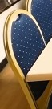
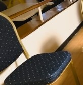
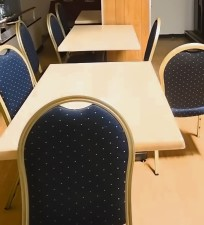

# Detected changes

Before: `clip01`  
After: `clip05`

## 0. moved: chair

Chair moved approx. 0.5 m toward the camera and to the left, within the foreground, next to the desk.

label confidence 0.73, geometry confidence 0.94

| before | after |
|---|---|
|  |  |

## 1. added: desk

New desk on a surface about 0.4 m high in the foreground, next to the chair, about 1.5 x 0.7 m footprint, 0.6 m tall.

label confidence 0.49, geometry confidence 0.96

| before | after |
|---|---|
|  |  |

Unobserved (seen by only one recording, not judged): 2044 before / 2439 after voxels.
