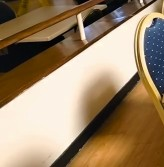

# Detected changes

Before: `clip01`  
After: `clip05`

## 0. moved: chair

Chair moved approx. 0.4 m to the left, within the foreground, next to the chair.

label confidence 0.75, geometry confidence 0.93

| before | after |
|---|---|
|  |  |

## 1. added: chair

New chair on the floor in the foreground, next to the chair, about 0.4 x 0.2 m footprint, 0.9 m tall.

label confidence 0.76, geometry confidence 0.95

| before | after |
|---|---|
|  |  |

Unobserved (seen by only one recording, not judged): 2213 before / 3356 after voxels.
