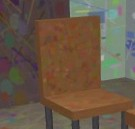
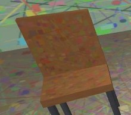
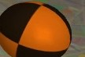
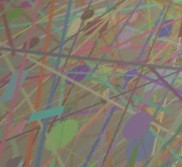
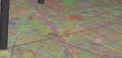
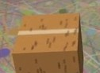

# Detected changes

Before: `data/synthetic/before.mp4`  
After: `data/synthetic/after.mp4`

## 0. moved: chair

Chair moved approx. 1.8 m to the right, within the middle of the room, next to the cardboard box.

label confidence 0.93, geometry confidence 1.00

| before | after |
|---|---|
|  |  |

## 1. removed: ball

Ball removed: it was on the floor in the middle-right part of the room, about 0.4 x 0.3 m footprint, 0.5 m tall; that space is now empty.

label confidence 0.99, geometry confidence 1.00

| before | after |
|---|---|
|  |  |

## 2. added: cardboard box

New cardboard box on the floor in the middle of the room, next to the chair, about 0.6 x 0.6 m footprint, 0.4 m tall.

label confidence 0.62, geometry confidence 1.00

| before | after |
|---|---|
|  |  |

Unobserved (seen by only one recording, not judged): 13565 before / 8923 after voxels.
